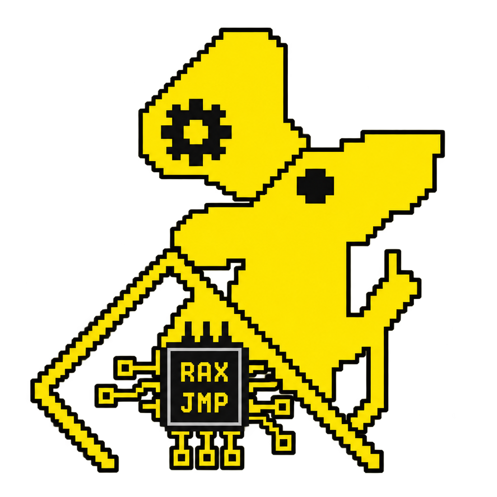
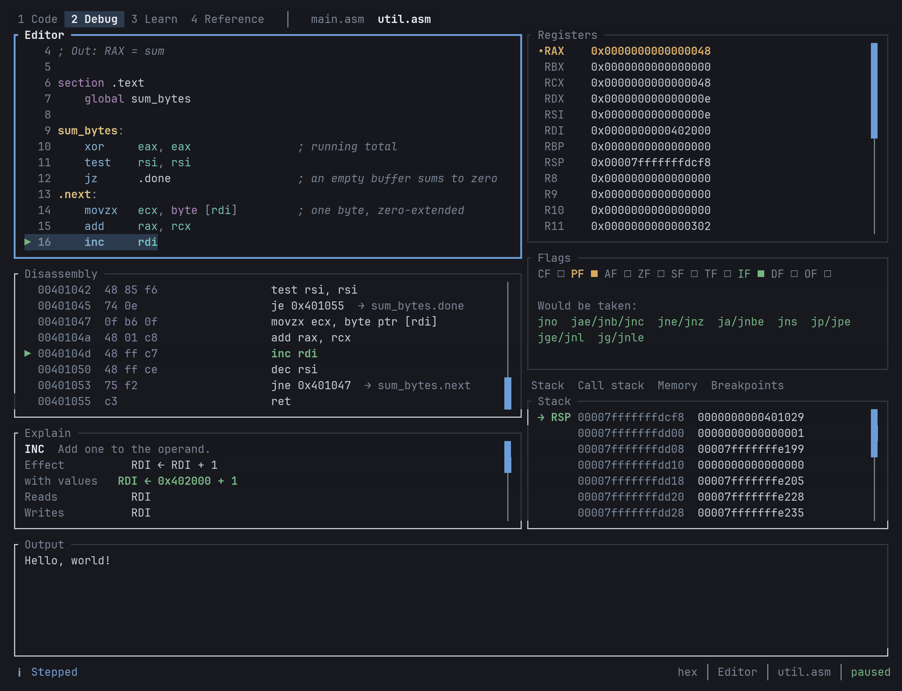
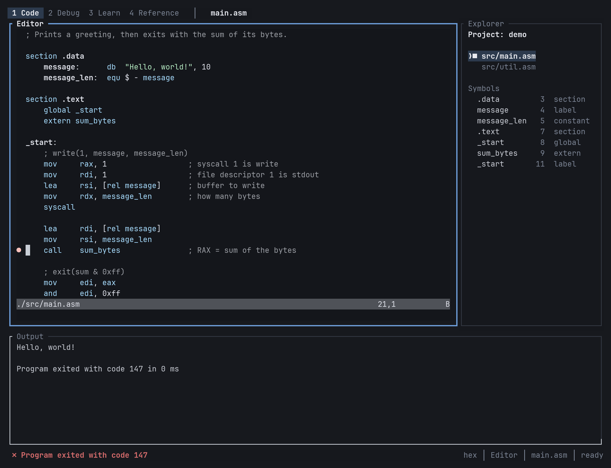

<div align="center">



# ratasm

**A terminal IDE and debugger for x86-64 assembly.**

[](https://github.com/tuna4ll/ratasm/actions/workflows/ci.yml)
[](https://crates.io/crates/ratasm)
[](LICENSE)

</div>



Write, build, run and debug assembly in one terminal window, with the registers,
flags and stack beside your source.

## Install

```sh
curl -fsSL https://github.com/tuna4ll/ratasm/releases/latest/download/install.sh | sh
```

Or `cargo install ratasm`. It needs `nasm` and `ld`; `gdb` for debugging and
`make` for Makefile projects. `ratasm doctor` checks them. Linux x86-64 only.

## Use

```sh
ratasm new hello      # or --make, or --libc
cd hello
ratasm
```

Any folder of `.asm` files works too; a `Makefile` is used when there is one.

| Key | Action |
| --- | --- |
| <kbd>F6</kbd> / <kbd>F5</kbd> | Build / run |
| <kbd>F9</kbd> / <kbd>F12</kbd> | Breakpoint / debug |
| <kbd>F7</kbd> / <kbd>F8</kbd> | Step / step over |
| <kbd>Ctrl</kbd>+<kbd>P</kbd> | Every command |
| <kbd>F1</kbd> | Lessons and reference |

More: [keys](docs/keybindings.md), [configuration](docs/configuration.md).



Programs you run here run natively, with your privileges.

## Licence

MIT. See [LICENSE](LICENSE). Contributing: [CONTRIBUTING.md](CONTRIBUTING.md).
